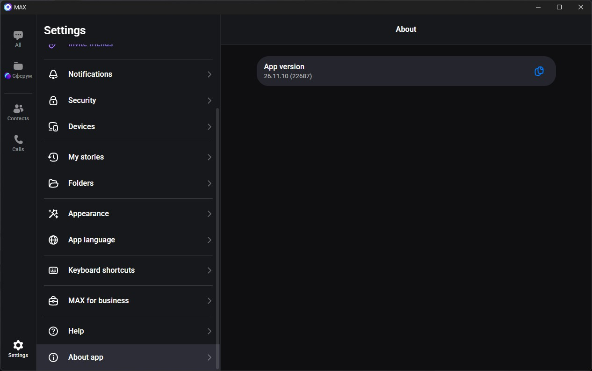

# WebMax



Настольное приложение для Windows, которое открывает веб-версию MAX в отдельном окне через WebView2.

## Возможности

- Отдельное окно для [web.max.ru](https://web.max.ru) на базе WebView2.
- Системная строка заголовка Windows с тёмным оформлением.
- Сворачивание в трей при закрытии окна и выход через меню трея.
- Один экземпляр приложения: повторный запуск активирует уже открытое окно.
- Горячие клавиши: `Alt+Left` / `Alt+Right`, `F5` / `Ctrl+R`, `Alt+Home`.

## Требования

- Windows 10/11
- [.NET 10 SDK](https://dotnet.microsoft.com/download) для сборки
- [WebView2 Runtime](https://developer.microsoft.com/microsoft-edge/webview2/) (обычно уже установлен в Windows)

## Сборка

```powershell
dotnet publish -c Release
```

Готовый файл: `bin\Release\net10.0-windows\win-x64\publish\WebMax.exe`
